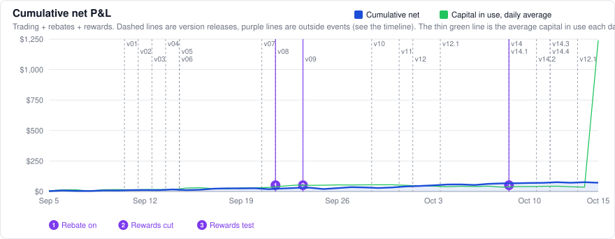
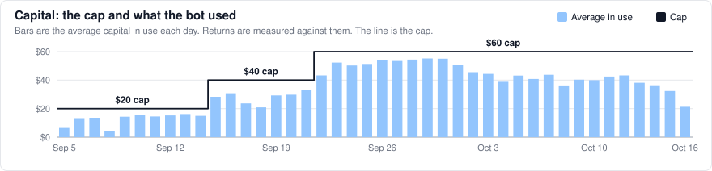
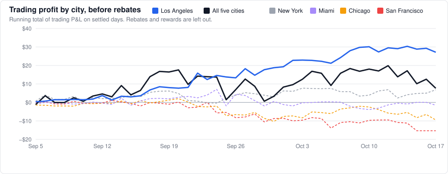
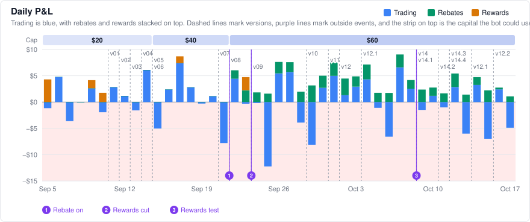
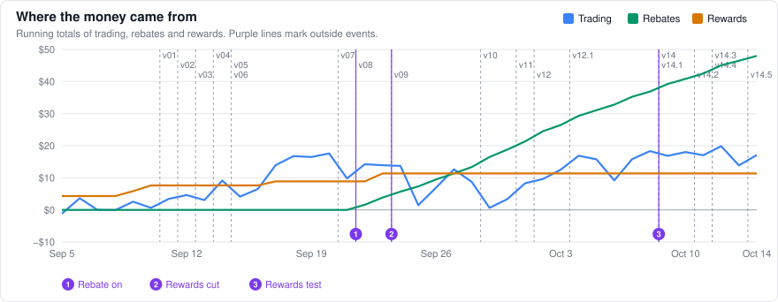
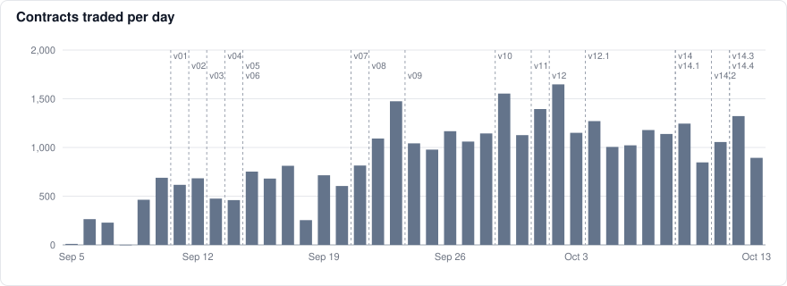
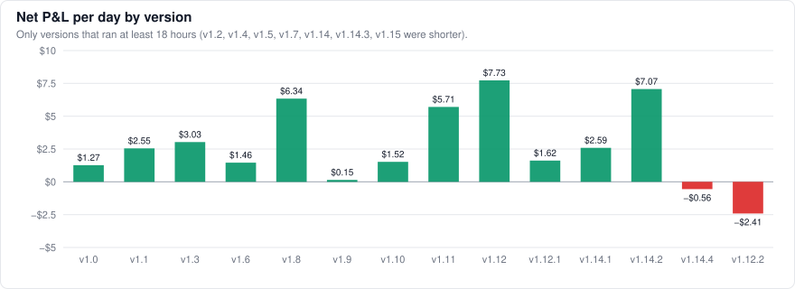
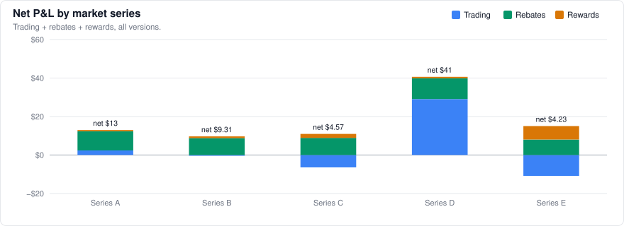

# prediction-market-making

This was a market-making bot that traded on Polymarket US with real money. It ran from September 5 to October 18, 2026, and it used Kalshi's prices for the same markets as its fair value.

It traded the daily high-temperature markets. Each city gets one market a day, split into brackets a couple of degrees wide, and the bracket that holds the day's high pays $1. The bot traded New York, Miami, Chicago, Los Angeles and San Francisco, and only Los Angeles on its last day.

The repository has no code, only the results. The bot was stopped on October 18 (see below). The results update at noon ET until its last positions settle, and then they're final.

Last update: October 18, 2026, 4:36 PM ET (43 days, September 5 to October 17).

## Returns

| | |
|---|---|
| Total return on capital in use | **+207.7%** (+$70.68 on an average of $34.02 in use) |
| Average daily return | **+4.8%** (net per day over capital in use per day, all 43 days) |
| Last 7 days | **+0.2% per day** (+$0.46 total, on $35 in use) |
| Latest version with a full day of data (v1.12.2) | **−6.0% per day** over 1.8 days, Oct 16 to Oct 17 |
| Version running now | v1.15, since Oct 18, 11:34 AM ET (its results appear here once it has a full settled day) |
| Days up | 29 of 43 (67.4%) |
| Days up, trading only | 23 of 43 (53.5%) |
| Best / worst day | +$9.05 (+20.7%) on Oct 7 / −$10.62 (−20.7%) on Sep 25 |
| Worst drawdown | −$10.62 (−20.7% of the capital in use at the time) |

Where it came from:

| | |
|---|---|
| Trading | +$7.67 |
| Maker rebates | +$51.65 |
| Liquidity rewards (now rare) | +$11.36 |
| Fills / contracts | 23,421 / 37,525 |
| Capital the bot can use | $20 now (earlier: $20 from Sep 5 to Sep 14, $40 from Sep 15 to Sep 21, $60 from Sep 22 to Oct 17) |
| Capital in use | $27 on average under v1.12.2, $34 over all 43 days |

## Why the bot stopped

Polymarket US changed its fee schedule. From October 19, makers that trade less than $10 million a month no longer get a maker rebate. This bot is far below that line, so its rebate goes to zero.

The rebate was most of the profit. From September 22 to October 17 the bot collected $51.65 in rebates and lost $2.12 on trading.

Without the rebate, only trading counts. This chart shows trading profit by city, with rebates and rewards taken out.

| | Trading total | Per day | Daily swing | Worst day | Worst drawdown |
|---|---:|---:|---:|---:|---:|
| Los Angeles only | +$27.14 | +$0.63 | $2.18 | −$3.57 | −$3.57 |
| All five cities | +$7.67 | +$0.18 | $4.52 | −$12.23 | −$16.95 |
| New York | +$6.85 | +$0.16 | $1.72 | −$4.48 | −$6.53 |
| Miami | −$1.50 | −$0.03 | $2.26 | −$8.97 | −$10.99 |
| Chicago | −$9.50 | −$0.22 | $1.68 | −$5.19 | −$12.28 |
| San Francisco | −$15.31 | −$0.36 | $1.93 | −$5.80 | −$16.44 |

Settled trade days from September 5 to October 17. Daily swing is the standard deviation of daily trading profit.

Los Angeles made more on its own than all five cities together, with less daily swing. San Francisco lost money on trading in both halves of the record and was dropped on October 16.

On October 18 the bot switched to Los Angeles only. That afternoon I stopped it, and it closed out what it still held.

Without the rebate, Los Angeles was the only place it made money, and even there the edge was small. Trading alone averaged +$0.63 a day over the whole record, and the last seven days lost $2.98. That's too close to zero to tell apart from luck.

On the last afternoon, the Los Angeles temperature moved into a new bracket. In the same second, a better-informed buyer filled both of the bot's quotes around it. That cost about $1.60, a few days of expected profit. Losses like that are the main risk in this strategy. Smaller orders make them smaller, but they don't stop them.

At this size the expected profit was a few dollars a month. It wasn't worth keeping it running.

The liquidity rewards don't change this. An overnight test aimed at them paid $0.21 for the night, so it was switched off.

## About that return

The percentage return looks suspiciously high, and it is real, but it doesn't scale with size. Every so often a much better-informed buyer shows up. They already know which bracket is mispriced, and they buy a huge number of contracts at the stale price, mostly out of market makers' resting orders. The bigger those orders are, the bigger the hit, and one of those days can wipe out a lot of normal ones.

That is why the size stays small. I think the strategy is already close to its ceiling. Small improvements can still add something, but probably not much. I can't be sure of that, though. It's just how things look right now.

## How it works

The bot keeps buy and sell orders resting on both sides of every bracket. It makes money from the spread when both sides fill and from the maker rebate the exchange pays on qualifying fills. Early on it also earned the exchange's liquidity rewards, but Polymarket cut that reward pool on Sep 23 and the bot has rarely qualified since (see the timeline). Kalshi lists the same contracts with deeper books, so the bot takes its fair value from Kalshi instead of predicting anything itself.

Most of the losses come from getting picked off by traders who know something before the market does, and much of the version history is about limiting that.

On the risk side, each market has an inventory limit and the bot has a hard cap on capital. Quotes are pulled when Kalshi moves, a dead-man switch cancels everything if the bot stalls, and a soft stop winds positions down after a bad run. A watchdog checks on all of it every few minutes.

Every change ships as a new version. Before a version goes live, I write down what it should change and how I'll measure it, and each change to the trading logic runs for at least 48 hours before the next one.

## Timeline

Outside events that changed the economics. They are the purple lines on the charts.

| Date (ET) | What happened |
|---|---|
| Sep 22 | Switched to collecting Polymarket's maker rebate on qualifying fills. |
| Sep 23 | Polymarket cut the liquidity reward pool for these markets by 75%. The bot has rarely qualified since. |
| Oct 9 | Started testing a way to qualify for liquidity rewards again, beginning with tiny orders. |
| Oct 18 | Switched to Los Angeles only, then stopped the bot that afternoon. Polymarket's maker rebate for small makers ends the next day. |

## Charts

## Versions

| Version | Started (ET) | What changed | Days | Net | Net/day | In use | Return/day | Trading | Rebates | Contracts |
|---|---|---|---:|---:|---:|---:|---:|---:|---:|---:|
| v1.0 | Sep 5, 11:34 AM | First version: a $20 test run that quotes both sides of every bracket off Kalshi prices. | 5.6 | +$7.13 | +$1.27 | $13 | +9.7% | −$0.48 | $0.00 | 1,709 |
| v1.1 | Sep 11, 2:33 AM | Joins the queue at the best price and goes after the liquidity rewards. | 1.8 | +$4.56 | +$2.55 | $15 | +17.4% | +$4.56 | $0.00 | 1,200 |
| v1.2 | Sep 12, 9:28 PM | Detects exchange halts and settled markets, and reports its safety limits to the monitor. | 0.2 | +$0.55 | too short | $17 | too short | +$0.55 | $0.00 | 91 |
| v1.3 | Sep 13, 1:39 AM | Waits for fill confirmation before taking on more risk (added after an exchange data outage). | 1.8 | +$5.35 | +$3.03 | $15 | +19.7% | +$5.35 | $0.00 | 863 |
| v1.4 | Sep 14, 8:03 PM | Combines the fixes above into a single build. | 0.3 | −$5.58 | too short | $18 | too short | −$5.58 | $0.00 | 87 |
| v1.5 | Sep 15, 4:04 AM | Raises the cap to $40 to cover more markets at the same order size. | 0.5 | −$0.72 | too short | $27 | too short | −$0.72 | $0.00 | 504 |
| v1.6 | Sep 15, 3:48 PM | Pulls resting quotes as soon as Kalshi moves. | 6.1 | +$8.91 | +$1.46 | $28 | +5.2% | +$7.65 | $0.00 | 3,961 |
| v1.7 | Sep 21, 6:08 PM | Restarts the bot as a long-running service, with no logic changes. | 0.7 | −$2.79 | too short | $33 | too short | −$2.79 | $0.00 | 359 |
| v1.8 | Sep 22, 10:11 AM | Uses larger orders and raises the cap to $60. | 1.7 | +$11.08 | +$6.34 | $52 | +12.2% | +$4.63 | $3.96 | 2,440 |
| v1.9 | Sep 24, 4:07 AM | Adds a soft stop that winds positions down after a losing stretch. | 5.2 | +$0.78 | +$0.15 | $53 | +0.3% | −$8.99 | $9.77 | 5,569 |
| v1.10 | Sep 29, 8:51 AM | Uses larger orders again. | 2.1 | +$3.14 | +$1.52 | $53 | +2.9% | −$2.62 | $5.76 | 2,799 |
| v1.11 | Oct 1, 10:16 AM | Drops an outside model input, so fair value comes from Kalshi alone. | 1.0 | +$5.53 | +$5.71 | $55 | +10.4% | +$3.08 | $2.45 | 1,328 |
| v1.12 | Oct 2, 9:32 AM | Quotes only same-day markets, so nothing is held overnight. | 2.4 | +$18.51 | +$7.73 | $42 | +18.3% | +$11.37 | $7.14 | 3,605 |
| v1.12.1 | Oct 4, 7:00 PM; again Oct 14, 11:00 AM | Adds a small safety fix for wind-downs. Back in use from Oct 14 to Oct 16, after the v1.14 trading changes measured worse, with the rewards test running at full size overnight. | 6.4 | +$10.35 | +$1.62 | $38 | +4.3% | −$1.52 | $11.87 | 6,683 |
| v1.14 | Oct 9, 11:16 AM | Fixes a few small bugs, reads prices faster, and starts a small test of a way back into the liquidity rewards. | 0.1 | −$5.07 | too short | $52 | too short | −$5.55 | $0.48 | 201 |
| v1.14.1 | Oct 9, 12:40 PM | Changes only when the rewards test pulls its orders. | 2.1 | +$5.34 | +$2.59 | $41 | +6.2% | +$1.44 | $3.90 | 2,097 |
| v1.14.2 | Oct 11, 2:13 PM | Adds safety rules to the rewards test. | 1.0 | +$7.19 | +$7.07 | $45 | +15.8% | +$5.31 | $1.88 | 1,160 |
| v1.14.3 | Oct 12, 2:37 PM | Runs the rewards test on one market at a time. | 0.0 | +$0.39 | too short | $34 | too short | +$0.10 | $0.29 | 126 |
| v1.14.4 | Oct 12, 3:13 PM | Keeps the rewards test's orders in place without gaps. | 1.8 | −$1.01 | −$0.56 | $37 | −1.5% | −$3.81 | $2.80 | 1,666 |
| v1.12.2 | Oct 16, 4:00 AM | Stops trading San Francisco, which lost money on trading in both halves of the record. The overnight rewards test now only uses same-day markets. | 1.8 | −$2.95 | −$1.61 | $27 | −6.0% | −$4.30 | $1.35 | 1,075 |

Versions that ran for less than about 18 hours say "too short" instead of per-day figures and aren't in the chart, since stretching a few hours into a full day isn't meaningful. Return per day is measured against the average capital the bot had in use while that version ran.

Versions were renumbered on October 18. Every version here is 1.x, so v12.1 is now v1.12.1.

## By city

Each city is one daily market on that day's high temperature. These totals include rebates and rewards.

| City | Fills | Contracts | Trading | Rebates | Rewards | Net |
|---|---:|---:|---:|---:|---:|---:|
| Chicago | 4,176 | 6,764 | −$9.50 | $10.29 | $2.09 | +$2.88 |
| Los Angeles | 5,849 | 9,530 | +$27.14 | $11.91 | $0.74 | +$39.79 |
| Miami | 4,314 | 6,603 | −$1.50 | $9.58 | $0.90 | +$8.98 |
| New York | 4,852 | 8,016 | +$6.85 | $11.06 | $0.64 | +$18.55 |
| San Francisco | 4,230 | 6,611 | −$15.31 | $8.81 | $6.99 | +$0.49 |

## Daily log

| Date | Version | Fills | Contracts | Trading | Rebates | Rewards | Net | In use | Return | Total |
|---|---|---:|---:|---:|---:|---:|---:|---:|---:|---:|
| 2026-10-17 | v1.12.2 | 374 | 716 | −$4.88 | $1.09 | $0.00 | −$3.79 | $32.79 | −11.6% | +$70.68 |
| 2026-10-16 | v1.12.2 | 203 | 417 | +$2.41 | $0.34 | $0.00 | +$2.75 | $21.27 | +12.9% | +$74.47 |
| 2026-10-15 | v1.12.1 | 588 | 1,244 | −$6.97 | $2.24 | $0.00 | −$4.73 | $32.39 | −14.6% | +$71.72 |
| 2026-10-14 | v1.12.1 | 407 | 816 | +$3.25 | $1.49 | $0.00 | +$4.74 | $35.81 | +13.2% | +$76.46 |
| 2026-10-13 | v1.14.4 | 460 | 893 | −$6.01 | $1.42 | $0.00 | −$4.59 | $38.14 | −12.0% | +$71.71 |
| 2026-10-12 | v1.14.2 | 653 | 1,322 | +$2.86 | $2.58 | $0.00 | +$5.44 | $43.30 | +12.6% | +$76.30 |
| 2026-10-11 | v1.14.1 | 495 | 1,056 | −$1.01 | $1.66 | $0.00 | +$0.65 | $42.53 | +1.5% | +$70.86 |
| 2026-10-10 | v1.14.1 | 396 | 847 | +$1.19 | $1.58 | $0.00 | +$2.77 | $39.96 | +6.9% | +$70.22 |
| 2026-10-09 | v1.14 | 640 | 1,245 | −$1.49 | $2.37 | $0.00 | +$0.88 | $40.31 | +2.2% | +$67.45 |
| 2026-10-08 | v1.12.1 | 543 | 1,139 | +$2.54 | $1.64 | $0.00 | +$4.18 | $35.70 | +11.7% | +$66.57 |
| 2026-10-07 | v1.12.1 | 543 | 1,179 | +$6.60 | $2.45 | $0.00 | +$9.05 | $43.75 | +20.7% | +$62.39 |
| 2026-10-06 | v1.12.1 | 448 | 1,022 | −$6.58 | $1.73 | $0.00 | −$4.85 | $40.78 | −11.9% | +$53.34 |
| 2026-10-05 | v1.12.1 | 466 | 1,005 | −$1.10 | $1.75 | $0.00 | +$0.65 | $43.17 | +1.5% | +$58.19 |
| 2026-10-04 | v1.12 | 587 | 1,271 | +$4.32 | $2.83 | $0.00 | +$7.15 | $38.82 | +18.4% | +$57.53 |
| 2026-10-03 | v1.12 | 490 | 1,150 | +$2.92 | $1.96 | $0.00 | +$4.88 | $44.36 | +11.0% | +$50.38 |
| 2026-10-02 | v1.12 | 755 | 1,648 | +$1.32 | $3.16 | $0.00 | +$4.48 | $45.57 | +9.8% | +$45.50 |
| 2026-10-01 | v1.11 | 570 | 1,395 | +$4.97 | $2.56 | $0.00 | +$7.53 | $50.44 | +14.9% | +$41.03 |
| 2026-09-30 | v1.10 | 476 | 1,126 | +$2.70 | $2.31 | $0.00 | +$5.01 | $55.01 | +9.1% | +$33.50 |
| 2026-09-29 | v1.10 | 691 | 1,553 | −$8.10 | $3.16 | $0.00 | −$4.94 | $55.17 | −9.0% | +$28.48 |
| 2026-09-28 | v1.9 | 636 | 1,144 | −$3.90 | $1.98 | $0.00 | −$1.92 | $54.39 | −3.5% | +$33.43 |
| 2026-09-27 | v1.9 | 599 | 1,060 | +$5.71 | $1.87 | $0.00 | +$7.58 | $53.44 | +14.2% | +$35.34 |
| 2026-09-26 | v1.9 | 651 | 1,167 | +$5.45 | $2.18 | $0.00 | +$7.63 | $54.16 | +14.1% | +$27.76 |
| 2026-09-25 | v1.9 | 546 | 978 | −$12.23 | $1.61 | $0.00 | −$10.62 | $51.33 | −20.7% | +$20.13 |
| 2026-09-24 | v1.9 | 590 | 1,042 | −$0.21 | $1.84 | $0.00 | +$1.63 | $50.26 | +3.2% | +$30.76 |
| 2026-09-23 | v1.8 | 900 | 1,474 | −$0.31 | $2.25 | $2.49 | +$4.43 | $52.32 | +8.5% | +$29.13 |
| 2026-09-22 | v1.8 | 775 | 1,092 | +$4.45 | $1.60 | $0.00 | +$6.05 | $43.32 | +14.0% | +$24.70 |
| 2026-09-21 | v1.6 | 840 | 815 | −$7.80 | $0.00 | $0.00 | −$7.80 | $33.28 | −23.4% | +$18.65 |
| 2026-09-20 | v1.6 | 622 | 604 | +$1.11 | $0.00 | $0.00 | +$1.11 | $29.75 | +3.7% | +$26.46 |
| 2026-09-19 | v1.6 | 731 | 715 | −$0.29 | $0.00 | $0.00 | −$0.29 | $29.24 | −1.0% | +$25.34 |
| 2026-09-18 | v1.6 | 262 | 254 | +$2.81 | $0.00 | $0.00 | +$2.81 | $20.91 | +13.5% | +$25.63 |
| 2026-09-17 | v1.6 | 834 | 812 | +$7.44 | $0.00 | $1.26 | +$8.70 | $23.64 | +36.8% | +$22.82 |
| 2026-09-16 | v1.6 | 696 | 681 | +$2.40 | $0.00 | $0.00 | +$2.40 | $30.77 | +7.8% | +$14.12 |
| 2026-09-15 | v1.5 | 806 | 752 | −$5.02 | $0.00 | $0.00 | −$5.02 | $28.32 | −17.7% | +$11.72 |
| 2026-09-14 | v1.3 | 506 | 460 | +$6.10 | $0.00 | $0.00 | +$6.10 | $14.97 | +40.7% | +$16.74 |
| 2026-09-13 | v1.3 | 496 | 475 | −$1.58 | $0.00 | $0.00 | −$1.58 | $16.19 | −9.7% | +$10.64 |
| 2026-09-12 | v1.1 | 726 | 683 | +$1.17 | $0.00 | $0.00 | +$1.17 | $15.22 | +7.7% | +$12.22 |
| 2026-09-11 | v1.1 | 658 | 617 | +$2.83 | $0.00 | $0.00 | +$2.83 | $14.51 | +19.5% | +$11.05 |
| 2026-09-10 | v1.0 | 737 | 689 | −$1.94 | $0.00 | $1.76 | −$0.18 | $15.76 | −1.2% | +$8.22 |
| 2026-09-09 | v1.0 | 503 | 463 | +$2.62 | $0.00 | $1.54 | +$4.16 | $14.33 | +29.0% | +$8.40 |
| 2026-09-08 | v1.0 | 2 | 1 | −$0.06 | $0.00 | $0.00 | −$0.06 | $4.30 | −1.4% | +$4.24 |
| 2026-09-07 | v1.0 | 237 | 229 | −$3.62 | $0.00 | $0.00 | −$3.62 | $13.59 | −26.7% | +$4.30 |
| 2026-09-06 | v1.0 | 273 | 264 | +$4.78 | $0.00 | $0.00 | +$4.78 | $13.30 | +35.9% | +$7.93 |
| 2026-09-05 | v1.0 | 10 | 10 | −$1.16 | $0.00 | $4.31 | +$3.15 | $6.46 | +48.8% | +$3.15 |

## Notes

- The raw data is in [`data/daily.csv`](data/daily.csv), [`data/versions.csv`](data/versions.csv) and [`data/series.csv`](data/series.csv).
- P&L is booked to the day each trade happened and valued at the official settlement price. Taker fees count against trading. Liquidity rewards are paid per market day, so they're booked to that day. Each day appears the morning after, once it has settled.
- Returns are measured against the capital the bot actually had in use, not the cap. That is the money in open positions plus resting orders, each order counted at what it would cost if it filled, averaged over the hours the bot was running each day. Most mornings it comes within a few dollars of the cap, until the previous day's markets settle. The cap is $20 now, and the rest of the account sits idle.
- Each update is checked against the actual account balance before it's published. The last check was off by $0.03, which comes from open positions and rounding.
- This repository doesn't contain any code, keys, order data or strategy settings.
